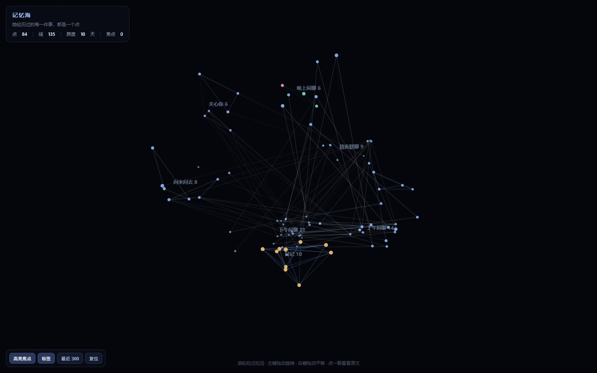

English ｜ [简体中文](README.md)

# memsea-coopanion



> The screenshot above is `demo/memory-sea-demo.html` — all of its data is fabricated by `demo/make-demo.mjs`. Open that file to see the animation.

Render a [Coopanion](https://github.com/Pal-AI-Lab/Coopanion) companion's memory as a rotatable 3D star sea on top of [memory-sea](https://github.com/asdfd3/3d-memory-sea), and give the bot a read-only recall tool so it can still dig up old conversations after its context has been cleared.

> **Read-only.** It never writes into the bot's memory. Clearing the context cannot touch it, because it is rebuilt from files on disk every time.

## What it does

- **Visible** — 1,400+ memories laid out in time: colour is kind, size is strength, click a star to read the original line.
- **Forgets** — strength decays with age; trivia fades in days, diaries last months. Not a blunt delete.
- **Remembers being mentioned** — when a later message refers to an old memory, that memory revives and its half-life lengthens (spacing effect).
- **Recallable** — a `memsea_recall` tool for the bot, so "what did you say on the 26th?" still works after a context handoff.

## Requirements

| | |
|---|---|
| Coopanion | 0.2.x, with its deployment directory at `data/home/<name>/` |
| Node | 20+ (Coopanion's bundled Electron can act as Node — see below) |
| memory-sea | included here in `src/` and `public/` (MIT, see NOTICE.md) |

## Quick start

### 1. Point it at the data

```bat
set COO_HOME=D:\Coopanion\data\home\companion
set OWNER_QQ=123456789      :: the human's QQ, optional
set SELF_QQ=987654321       :: the bot's own QQ, optional
```

`COO_HOME` is required. The two QQ numbers are only used for the "keep only her and him" filter — without them every scope is read.

### 2. Build the sea

```bat
node scripts/build-static.mjs
```

That writes `memory-sea.html`; double-click it. If the machine has no `node`, use Coopanion's Electron:

```bat
set ELECTRON_RUN_AS_NODE=1
"D:\Coopanion\Coopanion.exe" "scripts\build-static.mjs"
```

`scripts/refresh.example.cmd` does exactly this — edit two paths and double-click.

### 3. Give the bot the tool

`extension/cortico-world-memsea/` is a Cortico World package. Install it into Coopanion, enable it in the World page, restart. Details in that folder's README.

## Where the data comes from (read-only)

| What | Source |
|---|---|
| Messages | `data/runs/<run>/events.jsonl` — per-session stream: bubble lines, QQ in/out, typed text, voice transcripts, all with real timestamps |
| Long-term facts | `data/fact-store.json` |
| Diaries | `workspace/diary/*.txt` |
| Her own log | `workspace/log/*.md` |
| Videos watched | bilibili events in the run logs, folded into one line per day |
| Fallback | `workspace/handoffs/*.md`, `data/slim-archive/handoffs/*.md` |

The same sentence is often stored twice (fact store + chat log): it is deduplicated by normalised text within a 30-minute window, keeping the richer copy.

## Forgetting, echo, group policies

Three independent pieces:

- `forgetting.mjs` — strength = importance × 0.5^(age / half-life), with the half-life derived from importance (`0.55·e^(4.8×importance)` days). Below a floor the memory is gone. A capacity cap also keeps only the strongest 120 trivial memories.
- `echo.mjs` — a later message that talks about the same thing counts as a rehearsal: the decay origin moves to the last mention, and each mention multiplies the half-life by 1.25 (capped at 3×). Near-duplicates (the same line captured twice) do not count.
- `groups.json` — `skip` a whole group, or mark one as `fade` (kept, but pinned to the forgetting tier). See `groups.example.json`.

The importance table in `src/coo-adapt.mjs` (diary 0.92 / notes 0.85 / private 0.55 / owner-in-group 0.38 / other group members 0.22 …) is hand-tuned, not fitted.

## Layout

```
src/
  coo-adapt.mjs   deployment dir -> memory-sea's three arrays, with per-item importance
  runs.mjs        run logs (events.jsonl) -> messages
  dedupe.mjs      cross-source deduplication
  forgetting.mjs  the decay curve
  echo.mjs        rehearsal / spacing effect
  sea.mjs         collect -> echo -> forget -> link
  mind-sea.js     points / edges / clusters (upstream, one patch — see NOTICE)
  memory-store.js similarity (upstream)
  coo-server.mjs  optional: keep a server up on /api/scene
public/index.html the Canvas 2D renderer (upstream, one patch — see NOTICE)
scripts/          build, verify, group report, distribution checks
extension/        the recall tool for the bot (Cortico World)
tests/            fixture-driven tests, `node tests/run.mjs`
demo/             fabricated demo data + a ready-to-open page
```

## Tests

```bat
node tests/run.mjs
```

18 assertions against a throwaway fixture in a temp directory: reading facts/notes/run logs/diaries, dedup, ignoring UI activity, the daily watch digest, group policies (skip and fade), half-life growth with importance, the fade cap, rehearsal counting, near-duplicates not counting, all edges closing, weight spread, diary outweighing group chatter.

## Known limits

- Retrieval is **lexical** (Chinese bigrams + keywords + a small synonym table), not semantic: "hungry" will not find "hasn't eaten".
- Timestamps inferred from handoff notes (HH:MM only) may be off by a day; run logs are authoritative and preferred.
- Only the last `DAYS` days are read (default 30).
- The generated HTML **contains real conversations** — never commit or share it (`.gitignore` already blocks it).

## License

MIT for this repository. The bundled memory-sea code is MIT as well; attribution and the exact list of modifications are in [NOTICE.md](NOTICE.md).

---

## Author

**Shi1-0Yi** · [@shi1-0yi](https://github.com/shi1-0yi) · 2026

Released under the MIT license: use it, change it, redistribute it (commercial use included) as long as you **keep the copyright notice in `LICENSE`**.
`src/mind-sea.js`, `src/memory-store.js` and `public/index.html` come from [asdfd3/3d-memory-sea](https://github.com/asdfd3/3d-memory-sea) (MIT, by asdfd3); the modifications are listed in [NOTICE.md](NOTICE.md).
