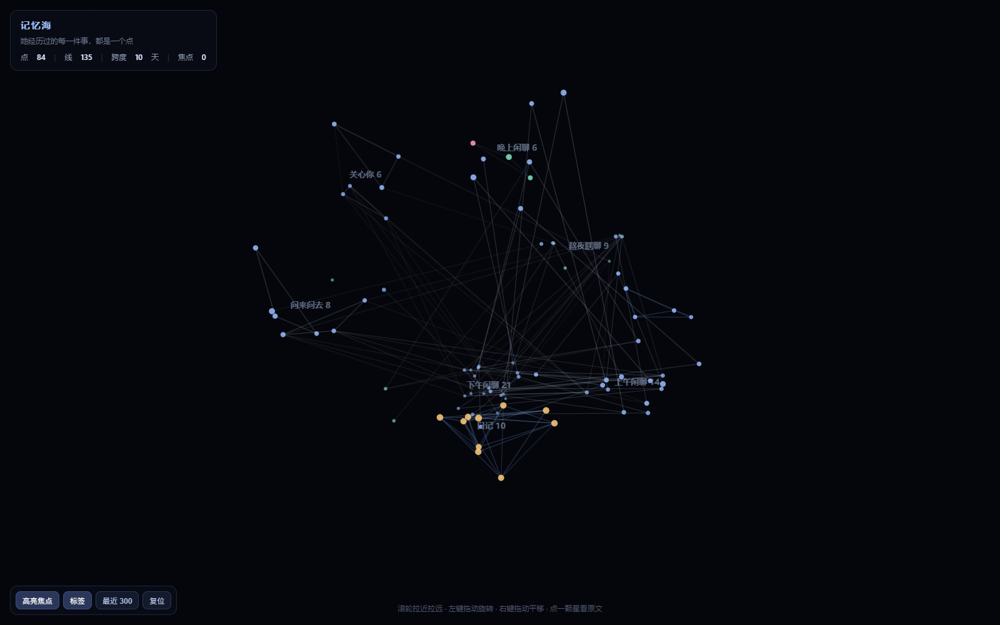

[简体中文](README.md) ｜ [English](README.en.md)

# memsea-coopanion



> 上图是 `demo/memory-sea-demo.html` 的截图，数据全部虚构（`demo/make-demo.mjs` 现造）。想看动效就直接打开那个文件。

把 [memory-sea](https://github.com/asdfd3/3d-memory-sea)（一片可以转的三维记忆星海）接到 [Coopanion](https://github.com/Pal-AI-Lab/Coopanion) 上：**只读**它的部署目录，把她说过的话、写过的日记、记下的事实，画成一片会淡、会忘、被提起又会亮的星海；再给她一个检索工具，上下文清空之后还能把旧事捞回来。

> Read-only. It never writes into the bot's memory, so clearing the context can never touch it.

## 它解决什么

- **看得见**：1450+ 条记忆按时间排成三维星海，颜色是类型，大小是强度，点开是原文。
- **会遗忘**：重要度 × 时间衰减，琐碎的几天就散；不是一刀切删除。
- **会被想起**：后来的话提到旧事，那条记忆就回春，而且越提越牢（间隔效应）。
- **能回捞**：给 bot 一个 `memsea_recall` 工具。上下文被清掉之后，她仍然能查到"10-26 那天你说过什么"。

## 前置条件

| 需要 | 说明 |
|---|---|
| Coopanion | 0.2.x，数据库用的是它的部署目录 `data/home/<部署名>/` |
| Node | 20+（Coopanion 自带的 Electron 就能当 Node 用，见下文） |
| memory-sea | 本仓库的 `src/`、`public/` 已包含（MIT，见 NOTICE.md） |

## 快速开始

### 1. 告诉它数据在哪

```bat
set COO_HOME=D:\Coopanion\data\home\companion
set OWNER_QQ=123456789      :: 对方（主人）的 QQ，可选
set SELF_QQ=987654321       :: bot 自己的 QQ，可选
```

`COO_HOME` 必填。两个 QQ 号填了才会按"只留她和他"过滤；不填就全收。

### 2. 生成那片海

```bat
node scripts/build-static.mjs
```

产出 `memory-sea.html`，双击就能看。

如果机器上没有 node（只有 Coopanion），用它的 Electron 当 node：

```bat
set ELECTRON_RUN_AS_NODE=1
"D:\Coopanion\Coopanion.exe" "scripts\build-static.mjs"
```

`scripts/refresh.example.cmd` 就是这么写的，改两行路径就能用。

### 3. 给她检索工具

`extension/cortico-world-memsea/` 是一个 Cortico World 扩展：装进 Coopanion 后，她多一个 `memsea_recall` 工具，还带一段环境提示词教她什么时候该查。安装步骤见那个目录的 README。

## 数据从哪来（只读）

| 星海里的东西 | 来源 |
|---|---|
| 消息 | `data/runs/<run>/events.jsonl`（每次会话一份，含气泡台词、QQ 收发、打字、语音转写，带真实时间戳） |
| 长期记忆 | `data/fact-store.json` |
| 日记 | `workspace/diary/*.txt` |
| 她的月志 | `workspace/log/*.md` |
| 看过的视频 | `data/runs/*/events.jsonl` 里的 bilibili 事件，按天压成一条 |
| 兜底 | `workspace/handoffs/*.md`、`data/slim-archive/handoffs/*.md` |

同一句话常在事实库和聊天里各存一份：按归一化文本 + 30 分钟窗口去重，留信息更全的那份。

## 遗忘、回声、群策略

三件事都在 `src/` 里，各自独立：

- `forgetting.mjs` — 强度 = 重要度 × 0.5^(放了几天 / 半衰期)，半衰期由重要度决定（`0.55·e^(4.8×重要度)` 天）；低于门槛就真的消失。另有一条容量上限：琐碎的最多留 120 条。
- `echo.mjs` — 后来的消息说得上同一件事，就算一次"复述"：衰减起点换成最后一次提及，并且每提一次半衰期 ×1.25（封顶 3 倍）。近重复（同一条话被抓两遍）不算复述。
- `groups.json` — 哪个群整个不要（`skip`）、哪个群只走遗忘栏（`fade`）。见 `groups.example.json`。

`src/coo-adapt.mjs` 里那张重要度表（日记 0.92 / 笔记 0.85 / 私聊 0.55 / 群里的对方 0.38 / 群友 0.22 …）是手工调的，不是拟合出来的。

## 目录

```
src/
  coo-adapt.mjs    Coopanion 部署目录 → memory-sea 的三段数组 + 每条的重要度
  runs.mjs         运行日志（events.jsonl）→ 消息
  dedupe.mjs       跨源去重
  forgetting.mjs   遗忘曲线
  echo.mjs         被提起就想起
  sea.mjs          收集 → 回声 → 遗忘 → 连边
  mind-sea.js      点 / 边 / 簇（上游，改了一处，见 NOTICE）
  memory-store.js  相似度（上游）
  coo-server.mjs   可选：常驻服务版（/api/scene）
public/index.html  三维渲染器（上游，改了一处，见 NOTICE）
scripts/           构建、校验、分组清单、分布检查
extension/         给 bot 的检索工具（Cortico World）
```

## 测试

```bat
node tests/run.mjs
```

18 条断言，全部用 `tests/fixture.mjs` 现造的假数据（临时目录），不碰真实部署：读事实库 / 笔记 / 运行日志 / 日记、同文去重、忽略界面动作、每日看片摘要、群策略（skip 与 fade）、半衰期随重要度变长、fade 压制重要度、复述计数、近重复不算复述、场景里边全部闭合、权重有梯度、日记权重高于闲聊。

## 已知边界

- 检索是**字面相似**（中文 bigram + 关键词），不是语义："饿了"查不到"没吃饭"。
- 时间字段靠正文推断的部分（交接笔记只有 HH:MM）可能差一天；运行日志是准的，已优先使用。
- 只看 `DAYS` 天（默认 30）。
- 生成出来的 HTML 里**含真实对话**，不要提交、不要外发。

## License

MIT（本仓库自己的代码）。内含的 memory-sea 代码同样是 MIT，署名与改动清单见 [NOTICE.md](NOTICE.md)。

---

## 作者

**Shi1-0Yi** · [@shi1-0yi](https://github.com/shi1-0yi) · 2026

本项目以 MIT 许可发布：你可以自由使用、修改、分发（包括商用），条件是**保留 `LICENSE` 里的版权声明**。
仓库里的 `src/mind-sea.js`、`src/memory-store.js`、`public/index.html` 来自 [asdfd3/3d-memory-sea](https://github.com/asdfd3/3d-memory-sea)（MIT，作者 asdfd3），改动见 [NOTICE.md](NOTICE.md)。
